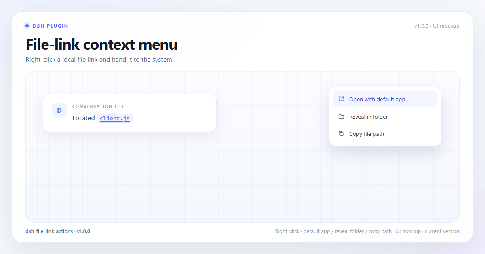
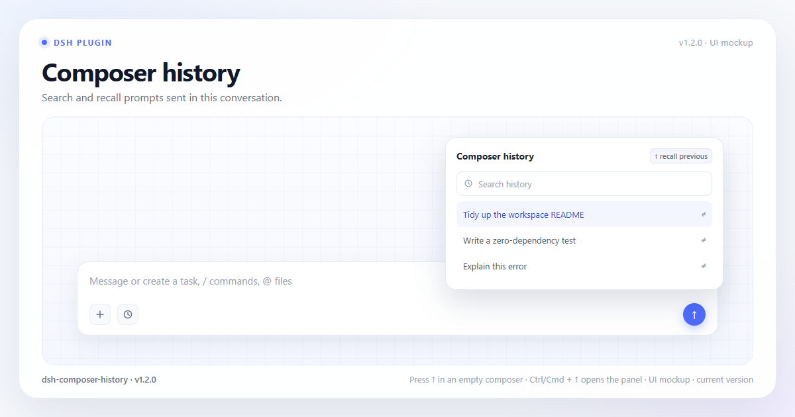
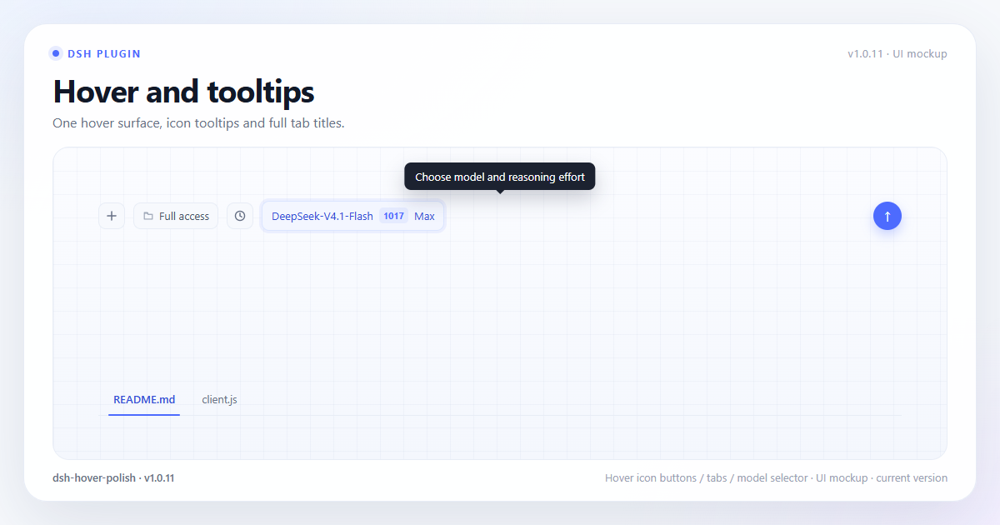
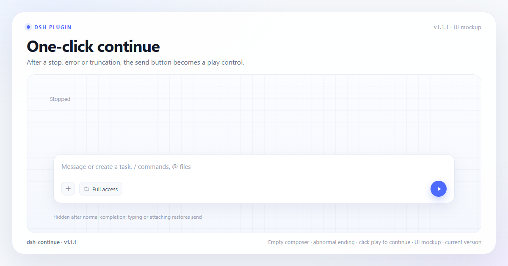
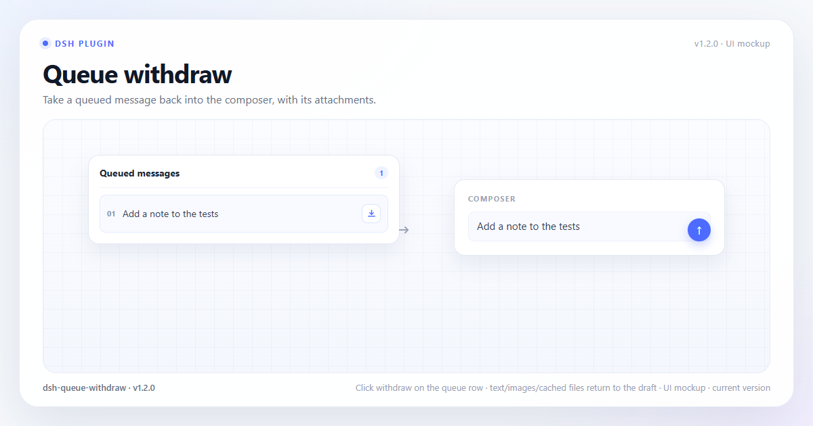

<div align="center">

# DSH Plugins

**Six independent DeepSeek Harness Web client plugins.**

Sidebar sections · File-link actions · Composer history · Hover · One-click continue · Queue withdraw

[](https://github.com/deepseek-ai/deepseek-harness)
[](scripts/check-all.mjs)
[](package.json)
[](LICENSE)

[简体中文](README.md) | English

[Plugins](#plugins) · [Quick start](#quick-start) · [Compatibility](#compatibility) · [Development](#development)

</div>

---

## What this is

A monorepo of Web client plugins for
[DeepSeek Harness](https://github.com/deepseek-ai/deepseek-harness) (DSH). The six packages can be
installed together or independently, enabled and disabled separately, and each is still a complete
DSH bundle.

They add missing everyday interactions only. They do not replace host components, take over
sessions, or reimplement the agent.

| Plugin | One line | Version | Checks |
|---|---|---|---|
| [`dsh-sidebar-sections`](packages/dsh-sidebar-sections) | Pinned / Projects / Recent / Archived sidebar | 2.3.0 | 67 |
| [`dsh-file-link-actions`](packages/dsh-file-link-actions) | File-link context menu: default app, reveal folder, copy path | 1.0.0 | 20 |
| [`dsh-composer-history`](packages/dsh-composer-history) | Searchable composer history with `↑` recall | 1.2.0 | 29 |
| [`dsh-hover-polish`](packages/dsh-hover-polish) | Unified button/tab hover and Codex-style tooltips | 1.0.11 | 34 |
| [`dsh-continue`](packages/dsh-continue) | Play control in the send button after a stop/error/truncation | 1.1.1 | 19 |
| [`dsh-queue-withdraw`](packages/dsh-queue-withdraw) | Withdraw queued messages back into the composer | 1.2.0 | 19 |

All packages: **188 zero-dependency checks**; no build step, no runtime npm dependencies.

## Quick start

### Install everything

```powershell
cd D:\dsh-plugins\dsh-plugins
node scripts/install-all.mjs --dry-run
node scripts/install-all.mjs
```

After installing, **fully quit and relaunch DSH**.

### Install one

From a Creator-preset session:

```text
plugin_manager(action="install_bundle", target="<monorepo>/packages/dsh-hover-polish")
```

`target` must be absolute. All six targets:

```text
<monorepo>/packages/dsh-sidebar-sections
<monorepo>/packages/dsh-file-link-actions
<monorepo>/packages/dsh-composer-history
<monorepo>/packages/dsh-hover-polish
<monorepo>/packages/dsh-continue
<monorepo>/packages/dsh-queue-withdraw
```

### Verify

```sh
node scripts/check-all.mjs
```

## Compatibility

| Item | Value |
|---|---|
| DSH | `0.2.1-rc.2` |
| Surface | Web GUI, Desktop Web GUI |
| Node | 22+ (tests and installer only) |
| Build | None |
| Runtime deps | None |

DSH is pre-stable; client APIs, slots and DOM contracts may change between releases.

---

## Plugins

### dsh-sidebar-sections

[](packages/dsh-sidebar-sections)
[](packages/dsh-sidebar-sections/scripts/check.mjs)

Turns the sidebar into four first-class sections: **Pinned / Projects / Recent / Archived**.


*Image notes: left is the four-section Pinned / Projects / Recent / Archived sidebar; middle is the section menu for grouping and ordering; right is the project menu with reveal, rename and delete actions. The screenshot reflects the current 2.3.0 UI.*

- Four independent sections; Archived can be hidden in settings
- Projects and Recent can group by project or use one flat list; projects order independently
- Drag ordering with insertion line and edge auto-scroll
- Hover and context menus: pin, archive, rename, fork, copy Session ID
- Hover preview card with title, project and time
- Full-width search; matching groups expand automatically
- Settings can restore safely deleted conversations; safe delete never calls the host delete API

**Usage:** use the sidebar directly; hover a row, right-click or press `Shift+F10` for menus, drag
rows to reorder.

**Data:** ordering, collapse state, grouping and safe-delete records live in `localStorage`; pins,
archive state and titles stay host-owned.

**Limitations:** sidebar view only; dragging is disabled while filtering; very old history outside
the loaded event window may not appear.

```text
plugin_manager(action="install_bundle", target="<monorepo>/packages/dsh-sidebar-sections")
```

[Docs](packages/dsh-sidebar-sections/README.en.md) · [中文](packages/dsh-sidebar-sections/README.md)

---

### dsh-file-link-actions

[](packages/dsh-file-link-actions)
[](packages/dsh-file-link-actions/scripts/check.mjs)

Adds a **context menu** to local file links in conversations.



*Image notes: right-click a file link to open the default app, reveal the folder or copy the path (1.0.0 mockup).*

- Open with the default application
- Reveal in the file manager
- Copy the resolved absolute path
- Works with file references and markdown file links; relative paths resolve against the workspace
- Left-click preview and host data stay unchanged

**Usage:** right-click a file link in conversation markdown and choose an action.

**Limitations:** local file links only; no workspace path means no reveal; depends on
`openWorkspacePath`.

```text
plugin_manager(action="install_bundle", target="<monorepo>/packages/dsh-file-link-actions")
```

[Docs](packages/dsh-file-link-actions/README.en.md) · [中文](packages/dsh-file-link-actions/README.md)

---

### dsh-composer-history

[](packages/dsh-composer-history)
[](packages/dsh-composer-history/scripts/check.mjs)

Adds **searchable composer history** with quick recall.



*Image notes: the clock entry and history panel search and recall prompts (1.2.0 mockup).*

- Panel lists real user prompts sent in the current conversation
- `↑` in an empty composer recalls the previous prompt; keep pressing to go older
- `↓` goes newer and restores the original draft
- Clock button or `Ctrl/Cmd + ↑` opens the searchable panel
- Panel and Settings can clear/delete local records
- Text only; no attachments or file references

**Data:** local records live in `localStorage` under `dsh.composerHistory.managedSettings`; cap 500.

**Limitations:** only `user/message` events in the loaded window; clearing/deleting does not modify
Session logs; state is lost after clearing site data or switching devices.

```text
plugin_manager(action="install_bundle", target="<monorepo>/packages/dsh-composer-history")
```

[Docs](packages/dsh-composer-history/README.en.md) · [中文](packages/dsh-composer-history/README.md)

---

### dsh-hover-polish

[](packages/dsh-hover-polish)
[](packages/dsh-hover-polish/scripts/check.mjs)

Unifies button/tab hover feedback and gives icon buttons Codex-style tooltips.



*Image notes: icon-button hover, the model-selector tooltip and file-tab hover (1.0.11 mockup).*

- Transparent icon buttons get one hover surface and transition
- Native icon-button `title` is replaced by a custom tooltip
- Model/reasoning, permission and add controls explain their action instead of repeating a label
- Tabs share hover feedback; file tabs reveal the full title/path
- Keyboard focus shows the same tooltip; `Esc`, scroll and blur dismiss

**Limitations:** only buttons with `title`/`aria-label`; menu items, dropdown options and
`data-dshhp-skip` controls are skipped; custom bubbles wait 650ms so host tooltips can win.

```text
plugin_manager(action="install_bundle", target="<monorepo>/packages/dsh-hover-polish")
```

[Docs](packages/dsh-hover-polish/README.en.md) · [中文](packages/dsh-hover-polish/README.md)

---

### dsh-continue

[](packages/dsh-continue)
[](packages/dsh-continue/scripts/check.mjs)

After a task is **stopped, errors or is truncated**, an empty composer's send button becomes a play
control.



*Image notes: after an abnormal ending, an empty composer turns the send button into play (1.1.1 mockup).*

- Clicking submits “继续” / “Continue” through the current Session's `prompt()`
- No draft insertion, no attachments, no bypassing the queue
- Typing or adding attachments restores the normal send button

**Shown for:** `aborted`, `blocked`, `error`, `max-tokens`, `interrupted`, and a trailing
`turn/start` without an end. Normal `completed` and `forked` endings do not show it.

**Limitations:** send-button/composer state only; depends on the host primary-button DOM; major layout
changes may need adaptation.

```text
plugin_manager(action="install_bundle", target="<monorepo>/packages/dsh-continue")
```

[Docs](packages/dsh-continue/README.en.md) · [中文](packages/dsh-continue/README.md)

---

### dsh-queue-withdraw

[](packages/dsh-queue-withdraw)
[](packages/dsh-queue-withdraw/scripts/check.mjs)

**Withdraws queued messages back into the composer.**



*Image notes: the queue row’s withdraw action returns the message and attachments to the composer (1.2.0 mockup).*

- Text appends to the existing draft instead of overwriting it
- Image attachments can be restored
- File attachments are cached in browser IndexedDB when selected and re-registered as draft files on
  withdraw
- Removes the queue item through public `Session.updateQueue(remove)`
- On rejection the previous draft is restored and the message stays queued

**Limitations:** only files selected after this plugin loaded are cached; pre-existing queued files
have no cache. Clearing site data, private browsing, an IndexedDB failure or a cache older than 24
hours can make a file unrestorable. Cache matching uses `name + size`.

```text
plugin_manager(action="install_bundle", target="<monorepo>/packages/dsh-queue-withdraw")
```

[Docs](packages/dsh-queue-withdraw/README.en.md) · [中文](packages/dsh-queue-withdraw/README.md)

---

## Repository layout

```text
.
├── packages/          # six complete DSH bundles
├── scripts/
│   ├── check-all.mjs
│   └── install-all.mjs
├── .github/workflows/check.yml
├── README.md / README.en.md
└── CHANGELOG.md
```

Each package contains `package.json`, `cordis.patch.yml`, a Host `index.js`, browser `client.js`,
locale files, READMEs, CHANGELOG and zero-dependency tests.

Packages are separate so they can be installed, rolled back and debugged independently. The
monorepo only unifies Git, CI and install scripts.

## Verification

```sh
node scripts/check-all.mjs
```

```text
all packages passed: 6 packages, 188 checks
```

| Package | Checks |
|---|---|
| `dsh-sidebar-sections` | 67 |
| `dsh-file-link-actions` | 20 |
| `dsh-composer-history` | 29 |
| `dsh-hover-polish` | 34 |
| `dsh-continue` | 19 |
| `dsh-queue-withdraw` | 19 |

## Privacy and data

- no telemetry, no extra server, no network reporting
- sidebar/history view data stays in browser `localStorage`
- queue-withdraw file cache stays in browser `IndexedDB` and is cleaned after withdrawal or when the
  queue item leaves
- host data stays host-API-driven; plugins never read credentials or write session logs

## Development

```sh
node scripts/check-all.mjs
node scripts/install-all.mjs
node scripts/install-all.mjs --dry-run
node scripts/install-all.mjs --profile "<profile directory>"
```

Release flow: bump the package's `package.json` version and `CHANGELOG.md`, run the full suite,
commit and tag the package. The root `CHANGELOG.md` records repository-level changes only.

## Migration and license

This repository starts with a fresh history and consolidates the previous standalone repositories;
see [MIGRATION.md](MIGRATION.md). Old directories remain as an archive.

[MIT](LICENSE). Each package also includes a LICENSE copy.
