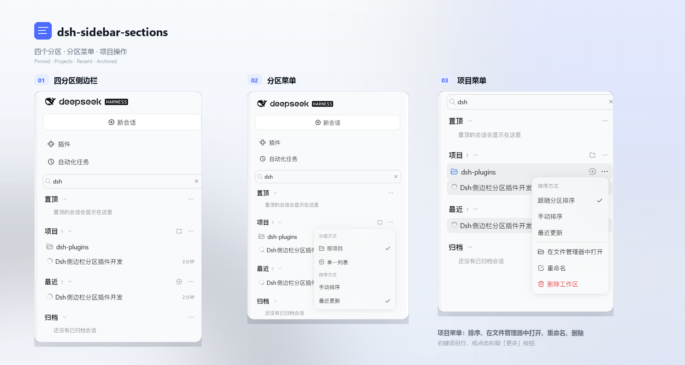

<div align="center">

# DSH Plugins

**Six small plugins that fill the missing everyday interactions in the DeepSeek Harness Web UI.**

Sidebar sections · File-link actions · Composer history · Hover polish · One-click continue · Queue withdraw

[](https://github.com/deepseek-ai/deepseek-harness)
[](CHANGELOG.md)
[](scripts/check-all.mjs)
[](package.json)
[](LICENSE)

[简体中文](README.md) | English

[Plugins](#plugins) · [Quick start](#quick-start) · [Compatibility](#compatibility) · [Architecture](#architecture) · [Verification](#verification) · [Privacy](#privacy-and-data-boundaries) · [Development](#development) · [License](#license)

</div>

---

## What this is

A monorepo of Web client plugins for [DeepSeek Harness](https://github.com/deepseek-ai/deepseek-harness)
(DSH). The six plugins can be installed together or independently; each package is a complete,
independently publishable DSH bundle.

They all solve the same kind of problem: **DSH's core interaction is already good, but a few everyday
actions are missing.** These plugins add only those actions — they do not replace host components,
take over sessions, or reimplement the agent.

| Plugin | Problem it solves | Version | Checks |
|---|---|---|---|
| [`dsh-sidebar-sections`](packages/dsh-sidebar-sections) | The sidebar only groups conversations under workspaces; pinned/archived views, manual project ordering and quick session management are missing | 2.3.0 | 67 |
| [`dsh-file-link-actions`](packages/dsh-file-link-actions) | File links only support left-click preview; there is no way to open in the default app or reveal the folder | 1.0.0 | 20 |
| [`dsh-composer-history`](packages/dsh-composer-history) | The composer has no history; reusing an old prompt means scrolling back through the conversation | 1.2.0 | 29 |
| [`dsh-hover-polish`](packages/dsh-hover-polish) | Button hover, native title tooltips and host tooltip placement are inconsistent | 1.0.11 | 34 |
| [`dsh-continue`](packages/dsh-continue) | After a stop, error or truncation, resuming requires typing “continue” | 1.1.1 | 19 |
| [`dsh-queue-withdraw`](packages/dsh-queue-withdraw) | Queued messages can only be edited, deleted or steered; taking one back into the composer has no entry point | 1.2.0 | 19 |

All packages together: **188 zero-dependency checks**, no build step, no runtime npm dependencies.

## Design principles

- **Add interaction, not a replacement host.** Plugins work through DSH slots, shell overlays, public
  Session actions and a small set of stable DOM contracts.
- **Host data stays authoritative.** Pin, archive, rename and fork still go through host APIs; the
  browser stores only view state, ordering overrides and history indexes.
- **Theme tokens first.** Colours come from `--dsw-*` variables and follow light/dark themes.
- **Zero runtime dependencies.** The browser half is a classic script loaded through
  `window.__ModuleLoader__.load`; the Host half is a no-op `apply` used for bundle discovery.
- **Bilingual docs.** Every package has `README.md`, `README.en.md`, its own changelog and tests.

## Quick start

### Install everything

For local development or an already-cloned repository:

```powershell
cd D:\dsh-plugins\dsh-plugins

# Inspect the profile changes first
node scripts/install-all.mjs --dry-run

# Create node_modules junctions, write profile dependencies and the bundle list
node scripts/install-all.mjs
```

The script:

1. creates a junction for each of the six packages under
   `~/.dsh/profiles/desktop/node_modules`;
2. writes `link:<monorepo>/packages/<name>` dependencies;
3. appends the six bundle names to `dsh.profile.bundles`.

After installing, **fully quit and relaunch DSH** so the new client bundles load at boot. HMR can
only avoid a restart when the change touches Host configuration without adding/replacing a browser
bundle.

### Install one plugin

From a session with the Creator preset:

```text
plugin_manager(action="install_bundle", target="<absolute monorepo path>/packages/dsh-sidebar-sections")
```

`target` must be absolute. Replace the last directory to install any package:

```text
<monorepo>/packages/dsh-sidebar-sections
<monorepo>/packages/dsh-file-link-actions
<monorepo>/packages/dsh-composer-history
<monorepo>/packages/dsh-hover-polish
<monorepo>/packages/dsh-continue
<monorepo>/packages/dsh-queue-withdraw
```

If the profile already has the same bundle, the call returns `already-installed`; remove it first, or
keep using the path-linked `install-all.mjs` flow for development.

### Common commands

```sh
node scripts/check-all.mjs     # run every package's zero-dependency suite
cd packages/dsh-hover-polish
node scripts/check.mjs         # run a single package
```

## Compatibility

| Item | Value |
|---|---|
| DSH | `0.2.1-rc.2` |
| Surface | Web GUI, Desktop Web GUI |
| Node | 22+ (tests and installer scripts only) |
| Build step | None |
| Runtime dependencies | None |
| Storage | Browser localStorage / IndexedDB; DSH profile; host session log |

DSH is pre-stable. The plugins rely on a few client APIs, slot names and DOM attribute contracts; a
DSH upgrade may require compatibility updates.

---

## Plugins

### 1. dsh-sidebar-sections

[](packages/dsh-sidebar-sections)
[](packages/dsh-sidebar-sections/scripts/check.mjs)

**Turns the sidebar into a real conversation browser.**

DSH groups conversations under workspaces and hides archived conversations behind a view switch.
Long-term use creates four different browsing needs — pinned, projects, recent and archived — but
the default sidebar mixes them.



**What it does:**

- Four first-class sections: **Pinned / Projects / Recent / Archived**
- Projects keep collapsible workspace groups; each project can be ordered independently
- Recent shows 8 conversations initially and reveals 20 more on demand
- Archived is a separate greyed-out section; restore before opening; can be hidden in settings
- Hover/focus a row to reveal archive, pin and `⋯` actions
- Right-click, `Shift+F10` and the Context Menu key open the same menu
- After ~400ms a preview card shows title, project and time; the pointer can travel into the card
- Manual drag ordering with insertion line, edge auto-scroll and cross-group guards
- Full-width search across titles, project names and directories; matching groups expand
- Settings tab: hide the archived section; restore safely deleted conversations
- Safe delete removes only the sidebar entry, never calls the host delete API, and can be undone

**How to use:**

1. The sidebar becomes four sections after install.
2. Hover a row for pin/archive actions; use `⋯`, right-click or `Shift+F10` for the full menu.
3. Drag rows to reorder; switch a section back to “Recently updated” in its menu.
4. Open **Settings → Plugins (built-in) → Sidebar Sections** to manage archiving and safe delete.

**Data and boundaries:**

- Pins, archived state and titles remain host-owned
- Ordering, collapse state, grouping, safe-delete tombstones live in `localStorage` under
  `dsh.sidebarSections.*`
- Real workspace ordering is written back through `workspaces.insertSessionBefore`
- Safe delete does not delete the session on disk; it hides the sidebar view

**Limitations:**

- Only affects the sidebar, not the conversation content area
- Dragging is disabled while filtering
- Older history outside the loaded event window may not appear
- DSH upgrades may change sidebar slot/menu contracts

**Install:**

```text
plugin_manager(action="install_bundle", target="<monorepo>/packages/dsh-sidebar-sections")
```

Docs: [中文](packages/dsh-sidebar-sections/README.md) · [English](packages/dsh-sidebar-sections/README.en.md)

---

### 2. dsh-file-link-actions

[](packages/dsh-file-link-actions)
[](packages/dsh-file-link-actions/scripts/check.mjs)

**Adds a system-level context menu to conversation file links.**

DSH renders local file paths as links and opens a document preview on left-click. Opening the file in
the system default app, or jumping to its folder, has no built-in entry point.

**What it does:**

- **Open with default app** — hand the file to the OS association
- **Reveal in file manager** — focus the file in the system file manager
- **Copy file path** — copy the resolved absolute path
- Works with conversation file references and markdown file links
- Resolves relative paths against the conversation workspace
- Leaves left-click preview and host data untouched

**How to use:**

1. Right-click a local file link in conversation markdown.
2. Choose “Open with default app”, “Reveal in folder” or “Copy file path”.
3. Left-click still opens DSH's document preview.

**Implementation notes:**

- Registers a `shell.overlay` document-level `contextmenu` handler
- Matches only conversation-markdown buttons with `fileLink` / `fileMention`
- Reads the path from `title`, resolves it against the session `cwd`
- Calls `remote.session.openWorkspacePath` for open/reveal

**Limitations:**

- Only local file links in conversation markdown; web links and image previews are skipped
- If no absolute path can be resolved from the conversation workspace, an error is shown
- Depends on DSH's `openWorkspacePath` contract

**Install:**

```text
plugin_manager(action="install_bundle", target="<monorepo>/packages/dsh-file-link-actions")
```

Docs: [中文](packages/dsh-file-link-actions/README.md) · [English](packages/dsh-file-link-actions/README.en.md)

---

### 3. dsh-composer-history

[](packages/dsh-composer-history)
[](packages/dsh-composer-history/scripts/check.mjs)

**Searchable, one-keystroke composer history.**

As a conversation grows, reusing an earlier prompt means scrolling back and copying it. The DSH
composer has no history and no “previous input” shortcut.

**What it does:**

- **History panel** — real user prompts sent in this conversation, newest first
- **Search** — filter by keyword to find older prompts
- **Direct recall** — press `↑` in an empty composer to fill the previous prompt
- **Reverse navigation** — `↓` moves to newer prompts and finally restores the original draft
- **Panel shortcut** — the clock button in the composer toolbar, or `Ctrl/Cmd + ↑`
- **Keyboard** — `↑`/`↓` select, `Enter` inserts, `Esc` closes
- **Clear panel history** — clear this conversation's plugin history
- **Settings management** — view records, delete one, clear all
- Chinese and English UI

**How to use:**

1. With an empty composer, press `↑` to recall the previous prompt.
2. Keep pressing `↑` to go older; `↓` goes newer and restores the empty draft at the end.
3. Click the clock button or press `Ctrl/Cmd + ↑` to open searchable history.
4. Open **Settings → Plugins → Composer History** to manage local records.

**Data and boundaries:**

- Reads `user/message` events from the current event window and keeps only real user input
- Writes back to the composer only; it never sends automatically
- Browsing history syncs prompts into a browser-local managed cache
- Managed data lives in `localStorage` under `dsh.composerHistory.managedSettings`
- Record cap 500, hidden-key cap 1000
- Clearing/deleting only affects plugin-local records, not Session messages

**Limitations:**

- Text only; attachments, images and file references are not recorded
- Older input outside the loaded event window is unavailable
- Settings can only manage prompts already recorded in this browser
- Clearing site data or changing devices loses the managed state

**Install:**

```text
plugin_manager(action="install_bundle", target="<monorepo>/packages/dsh-composer-history")
```

Docs: [中文](packages/dsh-composer-history/README.md) · [English](packages/dsh-composer-history/README.en.md)

---

### 4. dsh-hover-polish

[](packages/dsh-hover-polish)
[](packages/dsh-hover-polish/scripts/check.mjs)

**One consistent hover, tooltip and tab language across the UI.**

DSH's hover coverage is uneven: some controls only have the browser-native `title`, some icon buttons
have no background feedback, and some tooltips first paint at the lower-left before jumping into
place. Codex's UI has a consistent rhythm: sensible delay, matching bubble style, clear shortcuts and
predictable feedback on icon buttons.

**What it does:**

- **Native title upgrade** — icon-button `title` bubbles become Codex-style tooltips
- **Only when useful** — visible-text buttons do not repeat their own label; the send button is skipped
- **Explanatory bubbles** — model/reasoning, permission mode and add entry points describe the action
- **Shortcut dedupe** — repeated adjacent keycaps such as `Esc Esc` collapse to one
- **Tab hover** — file, conversation and settings tabs share feedback; selected tabs use a ring
- **Full tab title** — truncated file tabs reveal their full title/path
- **Host tooltip centering** — side/right-aligned host bubbles re-anchor to the control's center
- **No entry/exit flash** — bubbles stay hidden during the insertion window, then reveal once
  positioned; a 200ms grace period covers leaving
- **Icon-button hover** — transparent icon buttons get the same hover surface and short transition
- **Click dismissal** — opening a menu or clicking a control never leaves a hover bubble behind
- **Keyboard reachable** — focus shows the same tooltip; `Esc`, scroll and blur dismiss
- No host data mutation and no backend API

**How to use:**

1. Hover icon buttons, tabs and the model selector after install.
2. Tabs show their full title/path; complex controls explain their action.
3. Clicking a control dismisses the hover bubble immediately.

**Limitations:**

- Only buttons with `title` / `aria-label` / `aria-labelledby`; plain text buttons are skipped
- Menu items, dropdown options and `data-dshhp-skip` controls are skipped
- Custom bubbles wait 650ms so host tooltips can win
- Host tooltip content/shortcuts remain host-owned; the plugin only adjusts position and duplicate
  keycaps

**Install:**

```text
plugin_manager(action="install_bundle", target="<monorepo>/packages/dsh-hover-polish")
```

Docs: [中文](packages/dsh-hover-polish/README.md) · [English](packages/dsh-hover-polish/README.en.md)

---

### 5. dsh-continue

[](packages/dsh-continue)
[](packages/dsh-continue/scripts/check.mjs)

**Turns “continue” after a stop/error/truncation into a play control.**

After a task is stopped, interrupted or truncated, resuming usually means typing “continue”. That
keystroke carries no information. Normally completed turns intentionally never show Continue.

**What it does:**

- When the composer is empty, the conversation is idle and the last turn ended abnormally, the send
  button becomes a play icon
- Clicking submits a normal prompt through the current Session's `prompt()`
- No draft insertion, no attachments, no bypass of queue/lifecycle
- Typing or adding attachments restores the normal send button immediately
- On failure the play control returns with an error tooltip

**Visibility (turn reason):**

| Ending | Continue |
|---|---|
| `completed` normal completion | hidden |
| `forked` | hidden |
| `aborted` user stop | shown |
| `blocked` / `error` | shown |
| `max-tokens` truncation | shown |
| `interrupted` / trailing `turn/start` | shown |

**How to use:**

1. Stop a task, or wait for an error/truncation.
2. Clear the composer; a play icon appears in the send-button position.
3. Click it to submit “继续” / “Continue” without typing.

**Limitations:**

- Covers only the send-button/composer state; it does not implement retry or queue policy
- Depends on locating the host primary button in the DOM; major layout changes may need adaptation
- Normal completion and forked turns are intentionally hidden

**Install:**

```text
plugin_manager(action="install_bundle", target="<monorepo>/packages/dsh-continue")
```

Docs: [中文](packages/dsh-continue/README.md) · [English](packages/dsh-continue/README.en.md)

---

### 6. dsh-queue-withdraw

[](packages/dsh-queue-withdraw)
[](packages/dsh-queue-withdraw/scripts/check.mjs)

**Take a queued message back into the composer instead of only editing, deleting or steering it.**

DSH's queued-message row offers edit, delete and steer. To take a message back and adjust it, delete
loses the content and edit is less direct than restoring the composer.

**What it does:**

- Appends one withdraw action to every host queue row
- Restores text by appending to the existing draft, not overwriting it
- Image attachments: temporary cache first, then `session.readAttachment()`
- **File attachments**: caches the browser `File` in IndexedDB when selected; withdrawing registers
  it as a draft file again and lets DSH re-upload it
- Removes the item through public `Session.updateQueue(itemId, { kind: 'remove' })`
- On rejection restores the previous draft and leaves the item queued
- No persistent success notice: the disappearing row and restored draft are the feedback

**File-cache lifecycle:**

1. the user selects files and the Host calls `conversation.createDrafts()`;
2. the plugin writes each `File` to IndexedDB (plus an in-memory copy);
3. the message is queued while the cache stays available;
4. on withdraw the cache is matched by `name + size` and restored through `createDrafts` +
   `addAttachments`;
5. successful withdrawal, the queue item leaving the queue, or a 24-hour age cleans the cache.

**How to use:**

1. Send while the agent is running; the message enters the queue.
2. Click the withdraw action on the queued row.
3. Text, images and files return to the composer and the row disappears.

**Limitations:**

- Only files selected after this plugin loaded are cached; pre-existing queued files cannot be restored
- Clearing site data, private browsing, IndexedDB write failures or a cache older than 24 hours can
  make a file unrestorable
- Cache matching uses `name + size`; identical names/sizes may match the most recent entry
- Image/file restoration relies on the draft attachment registry and may need compatibility updates
  after a DSH upgrade

**Install:**

```text
plugin_manager(action="install_bundle", target="<monorepo>/packages/dsh-queue-withdraw")
```

Docs: [中文](packages/dsh-queue-withdraw/README.md) · [English](packages/dsh-queue-withdraw/README.en.md)

---

## Architecture

### Layout

```text
.
├── packages/
│   ├── dsh-sidebar-sections/
│   ├── dsh-file-link-actions/
│   ├── dsh-composer-history/
│   ├── dsh-hover-polish/
│   ├── dsh-continue/
│   └── dsh-queue-withdraw/
├── scripts/
│   ├── check-all.mjs
│   └── install-all.mjs
├── .github/workflows/check.yml
├── README.md / README.en.md
├── MIGRATION.md
└── CHANGELOG.md
```

### Every package contains

- `package.json` — `dsh.bundle.patch` and `dsh.client` manifest
- `cordis.patch.yml` — inserts one Host Loader row
- `index.js` — Host half (no-op `apply`, used for bundle discovery)
- `client.js` — browser half, a plain classic script
- `locale/` — Plugin Manager title/description
- `scripts/check.mjs` — zero-dependency suite
- `README.md` / `README.en.md` / `CHANGELOG.md` / `LICENSE`

### Why not one giant plugin

The features live in different DSH slots, different injection services and different failure
surfaces. Keeping them as packages means:

- install, enable and roll back independently
- test and debug independently
- one failing plugin does not take down the others
- each package keeps its own version and changelog

The monorepo only unifies Git, CI, install scripts and repository docs.

## Verification

```sh
node scripts/check-all.mjs
```

Current result:

```text
all packages passed: 6 packages, 188 checks
```

| Package | Checks |
|---|---|
| `dsh-sidebar-sections` | 67 |
| `dsh-file-link-actions` | 20 |
| `dsh-composer-history` | 29 |
| `dsh-hover-polish` | 34 |
| `dsh-continue` | 19 |
| `dsh-queue-withdraw` | 19 |

CI runs the same script on every push and pull request.

## Privacy and data boundaries

- no telemetry, no extra server, no network reporting
- sidebar and composer-history view data stay in browser `localStorage`
- the withdraw file cache stays in browser `IndexedDB` and is cleaned after success or when the queue
  item leaves
- pins, archive state, renames and forks remain host-owned and host-API-driven
- plugins never read credentials, write session logs or modify agent results

## Development

```sh
node scripts/check-all.mjs          # all tests
node scripts/install-all.mjs        # install all plugins into the profile
node scripts/install-all.mjs --dry-run
node scripts/install-all.mjs --profile "<profile directory>"
```

Single package:

```sh
cd packages/dsh-hover-polish
node scripts/check.mjs
```

Release flow:

1. bump the package's `package.json` version and update its `CHANGELOG.md`;
2. run `node scripts/check-all.mjs`;
3. commit and tag the package release, for example `dsh-hover-polish-v1.0.12`;
4. the root `CHANGELOG.md` records repository-level changes only.

## Migrated from standalone repositories

This repository starts with a fresh history and consolidates the previously independent plugin
repositories. See [MIGRATION.md](MIGRATION.md). The old directories remain as an archive and are no
longer install sources.

## License

[MIT](LICENSE). Each package also includes its own LICENSE copy.
